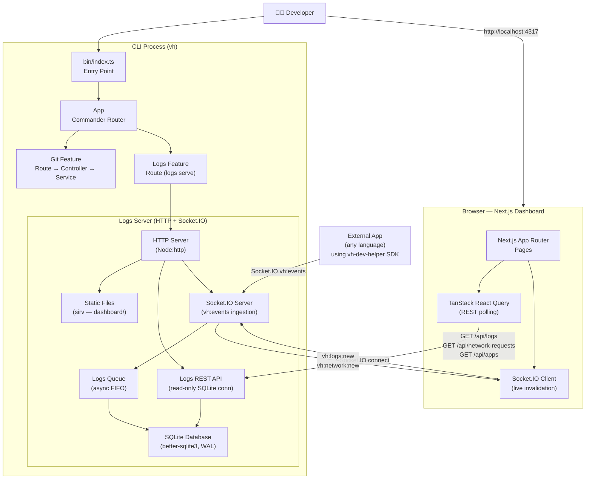
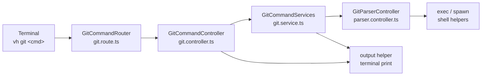
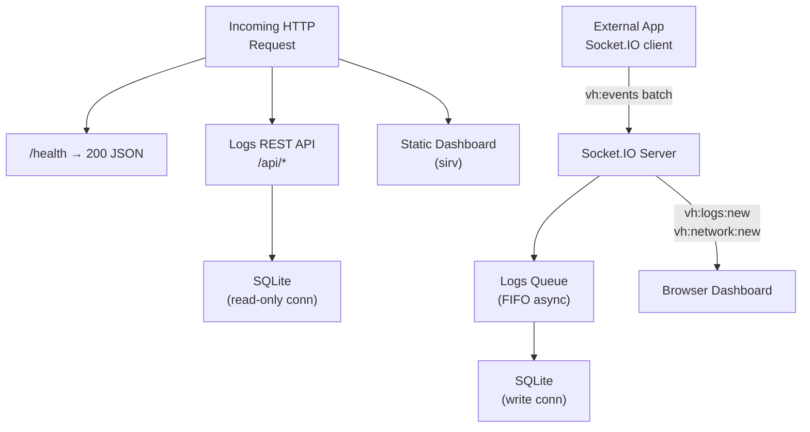
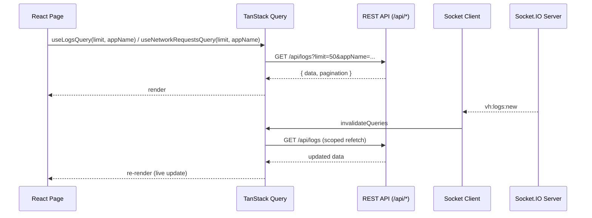
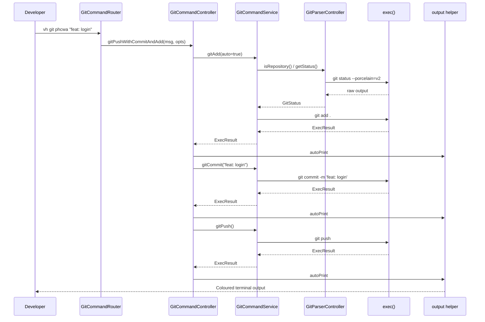
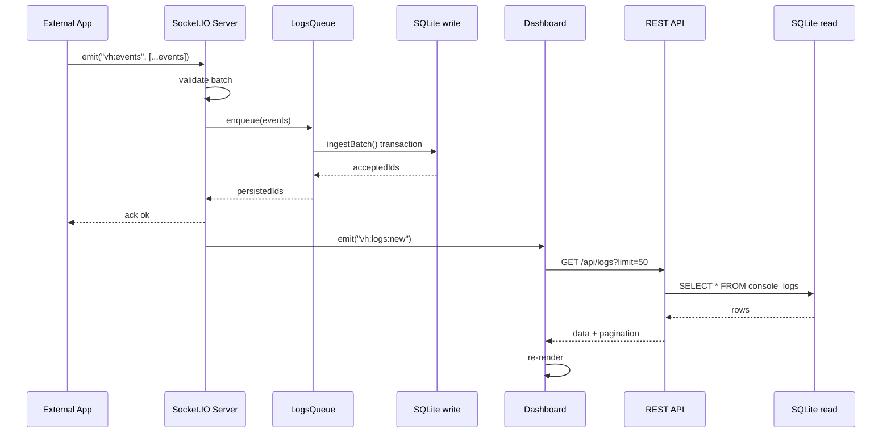
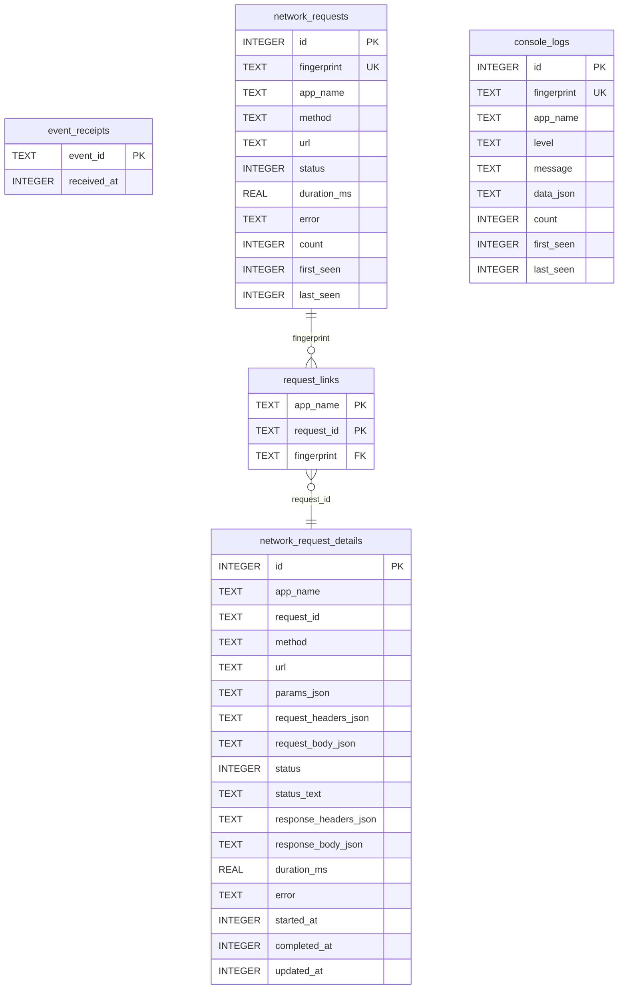
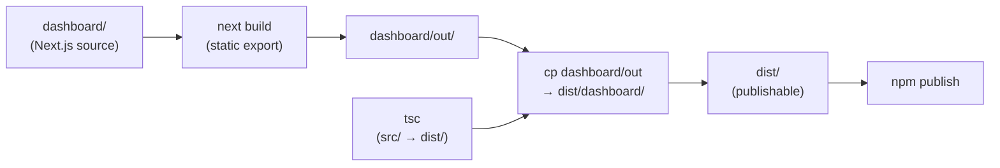

# vh-dev-helper — Architecture

> **Developer productivity CLI and real-time observability dashboard for local development.**

---

## Table of Contents

1. [Overview](#overview)
2. [High-Level Architecture](#high-level-architecture)
3. [Project Structure](#project-structure)
4. [Backend CLI — `src/`](#backend-cli--src)
   - [Entry Point](#entry-point)
   - [Feature: Git](#feature-git)
   - [Feature: Logs Server](#feature-logs-server)
   - [Shared Utilities](#shared-utilities)
5. [Frontend Dashboard — `dashboard/`](#frontend-dashboard--dashboard)
   - [Pages](#pages)
   - [Components](#components)
   - [Data Layer](#data-layer)
6. [Data Flow Diagrams](#data-flow-diagrams)
   - [Git Command Flow](#git-command-flow)
   - [Logs Ingestion & Live Update Flow](#logs-ingestion--live-update-flow)
7. [Database Schema](#database-schema)
8. [API Reference](#api-reference)
9. [Build & Distribution](#build--distribution)
10. [Key Dependencies](#key-dependencies)

---

## Overview

`vh-dev-helper` is a **monorepo** composed of two parts:

| Part | Technology | Purpose |
|------|------------|---------|
| **CLI (`src/`)** | Node.js + TypeScript + Commander | Interactive git shortcuts, log-collection server |
| **Dashboard (`dashboard/`)** | Next.js 16 + React 19 + TanStack Query | Real-time web UI for logs and network monitoring |

The CLI binary (`vh`) is published to npm. At runtime it bundles and serves the pre-built Next.js dashboard via a lightweight HTTP + Socket.IO server — no separate deployment needed.

---

## High-Level Architecture



---

## Project Structure

```
dev-helper/
├── src/                        # CLI source (TypeScript, CommonJS output)
│   ├── bin/
│   │   └── index.ts            # #!/usr/bin/env node  — shebang entry
│   ├── app.ts                  # App class: initialises Commander, registers routers
│   ├── features/
│   │   ├── git/                # Git command feature
│   │   │   ├── git.route.ts    # Commander sub-commands registration
│   │   │   ├── git.controller.ts  # Command handlers (input → service → output)
│   │   │   └── git.service.ts  # Business logic (git add/commit/push/pull/etc.)
│   │   └── logs/               # Log server feature
│   │       ├── logs.route.ts   # "logs serve" command — wires HTTP + Socket.IO + API
│   │       ├── logs.api.ts     # REST API handler (read-only queries)
│   │       ├── logs.database.ts  # SQLite schema + write operations (ingestBatch)
│   │       ├── logs.socket.ts  # Socket.IO server — event validation + fan-out
│   │       ├── logs.queue.ts   # Async FIFO queue — serialises DB writes
│   │       ├── logs.store.ts   # (reserved)
│   │       ├── logs.service.ts # (reserved)
│   │       └── logs.types.ts   # (reserved)
│   └── shared/
│       ├── config/             # Configuration loading & defaults
│       ├── constants/          # Env-var names
│       ├── errors/             # Base / CLI / Runtime error classes
│       ├── events/             # Event-bus (internal pub/sub)
│       └── helpers/
│           ├── gitParsers/     # Git output parsers (porcelain v2, branch refs)
│           │   ├── parser.controller.ts  # GitParserController — high-level git queries
│           │   ├── parser.services.ts    # GitParser / GitDisplay / GitStatusHelper
│           │   └── parser.types.ts       # GitStatus, GitBranch, GitChangedFile…
│           ├── logger/         # Internal logger
│           ├── output/         # Coloured terminal output helpers
│           ├── prompt/         # @clack/prompts wrappers
│           ├── shell/
│           │   ├── exec.ts     # Promisified child_process.exec wrapper
│           │   └── spawn.ts    # Promisified child_process.spawn wrapper
│           └── ui/
│               ├── stepProgress/  # CLI step-progress renderer
│               └── writer/        # Terminal write helpers
│
├── dashboard/                  # Next.js dashboard source
│   ├── app/                    # App Router pages
│   │   ├── layout.tsx          # Root layout (Providers + LiveUpdates + AppShell)
│   │   ├── page.tsx            # /  → Dashboard home (stats)
│   │   ├── console/page.tsx    # /console → Console logs
│   │   ├── network/page.tsx    # /network → Network requests
│   │   ├── docs/page.tsx       # /docs → Swagger/Scalar interactive API docs
│   │   ├── performance/page.tsx # /performance → Waterfall timeline & latency profiler
│   │   ├── git/page.tsx        # /git → Visual Git dashboard (working tree, diffs, log)
│   │   ├── events/page.tsx     # /events  → Events view
│   │   ├── projects/page.tsx   # /projects
│   │   └── settings/page.tsx   # /settings
│   ├── components/
│   │   ├── layout/             # AppShell, Sidebar, Topbar, ConnectionStatus, LiveUpdates
│   │   ├── dashboard/          # StatCard
│   │   ├── network/            # RequestTable, RequestDetails
│   │   ├── console/            # ConsolePanel
│   │   └── shared/             # EmptyState
│   ├── hooks/
│   │   └── use-live-updates.ts # Socket.IO listener → React Query invalidation
│   ├── lib/
│   │   ├── api-client.ts       # Typed fetch wrapper for all REST endpoints
│   │   ├── queries.ts          # TanStack Query hooks (useLogsQuery, useNetworkRequestsQuery…)
│   │   ├── query-client.ts     # Shared QueryClient instance
│   │   ├── socket-client.ts    # Singleton Socket.IO client
│   │   ├── utils.ts            # Shared utilities (cn, formatters…)
│   │   └── prefrences.tsx      # User preferences context
│   └── types/
│       ├── apps.ts             # App type
│       ├── logs.ts             # ConsoleLog type
│       └── network.ts          # NetworkRequest / NetworkRequestDetail types
│
├── package.json                # Root — CLI build scripts, CLI dependencies
├── tsconfig.json               # Root TypeScript config (src/ → dist/)
└── ARCHITECTURE.md             # This file
```

---

## Backend CLI — `src/`

### Entry Point

```
bin/index.ts  →  app.ts (App)  →  Commander program
```

`App.initialiazeCommandar()` creates the top-level `vh` Commander program and registers all feature routers before calling `program.parse()`.

---

### Feature: Git

Three-layer MVC pattern mirroring a web controller structure.



#### Git Commands

| Command | Alias | Description |
|---------|-------|-------------|
| `vh git init` | — | Initialise repo |
| `vh git status` | — | Show working tree status |
| `vh git add` | — | Interactive file staging |
| `vh git commit [msg]` | — | Commit staged changes |
| `vh git push` | — | Push to remote (auto-upstream) |
| `vh git pull [branch]` | — | Pull from remote |
| `vh git checkout [branch]` | — | Interactive checkout |
| `vh git branch` | — | List all branches |
| `vh git cwa [msg]` | Commit With Add | `git add .` → `git commit` |
| `vh git phcwa [msg]` | Push+Commit+Add | `add` → `commit` → `push` |
| `vh git plcwa [msg] [branch]` | Pull+Commit+Add | `add` → `commit` → `pull` |
| `vh git puplwc [msg] [branch]` | Push+Pull+Commit | 4-step: `add` → `commit` → `pull` → `push` |
| `vh git cwca [msg] [branch]` | Checkout+Commit+Add | `add` → `commit` → `checkout` |
| `vh git stash` | — | Interactive stash (push/list/pop/apply/drop) |
| `vh git merge [branch]` | — | Merge branch with autocomplete & `--abort` |
| `vh git diff` | — | Show working tree diff (`-s, --staged` for index) |
| `vh git log` | — | Decorated graph log (`-n, --limit`) |
| `vh git reset` | — | Soft / hard reset (`--head` to discard unstaged) |
| `vh git tag` | — | Interactive tags (list/create/delete) |
| `vh git rebase [branch]` | — | Rebase current branch with `--abort` |
| `vh git remote` | — | Manage remotes (list/add/remove) |
| `vh git cherry-pick [commit]` | — | Pick commits with interactive log history |
| `vh git clean` | — | Safe untracked cleanup with dry-run preview |
| `vh git restore [file]` | — | Discard changes per file interactively |
| `vh git show [commit]` | — | Inspect commit diff and metadata |
| `vh git fetch` | — | Fetch remote refs (`-a, --all` with prune) |

All commands accept `--json` / `-j` to output raw JSON for scripting.

#### Git Status Parser (`parser.services.ts`)

Parses `git status --porcelain=v2 --branch -z` output into typed `GitStatus` objects including:
- Current branch name, upstream, ahead/behind counts
- Per-file change type (`modified`, `untracked`, `deleted`, `renamed`, `conflict`)

---

### Feature: Logs Server

**Command:** `vh logs serve [-p <port>]` (default port `4317`)

Spins up a single HTTP server with three responsibilities:



#### Logs Queue (`logs.queue.ts`)

Provides backpressure-safe, in-order DB writes:
- Max 5,000 pending events (configurable)
- Uses `setImmediate` to yield the event loop between batches
- Serialised (single worker at a time) — SQLite single-writer-safe

#### Logs Database (`logs.database.ts`)

SQLite database at `~/.vh-dev-helper/vh-logs.sqlite` (override via `VH_DB_PATH`).

Two connections: **write** (normal) and **read-only** (for the API). WAL mode enables concurrent reads without blocking writes.

Deduplication via SHA-256 fingerprint (`app_name + method + url` for network, `app_name + level + message + data` for logs). Repeated events increment a `count` column.

---

### Shared Utilities

| Module | Purpose |
|--------|---------|
| `helpers/shell/exec.ts` | Promisified `child_process.exec`, returns `ExecResult {stdout, stderr, success, durationMs}` |
| `helpers/shell/spawn.ts` | Promisified `child_process.spawn` for streaming output |
| `helpers/output/index.ts` | Coloured terminal output: `info`, `success`, `error`, `currentBranch`, `autoPrint` |
| `helpers/prompt/prompt.ts` | `@clack/prompts` wrappers: `input`, `confirm`, `multiselect` |
| `helpers/logger/` | Internal structured logger |
| `shared/errors/` | `BaseError`, `CliError`, `RuntimeError` hierarchy |
| `shared/events/event-bus.ts` | Internal EventEmitter-based pub/sub |

---

## Frontend Dashboard — `dashboard/`

A **Next.js 16 App Router** application exported as a static site and bundled into the CLI's `dist/dashboard/` directory.

### Pages

| Route | Component | Data |
|-------|-----------|------|
| `/` | Dashboard home | Stat cards (apps, log counts) |
| `/console` | ConsolePanel | `GET /api/logs` |
| `/network` | RequestTable + RequestDetails | `GET /api/network-requests`, `GET /api/network-request-details` |
| `/docs` | DocsPage + ApiRequestRunner | Swagger & Scalar style API reference (unique route aggregation, OpenAPI export, code snippets, parameters table, responses accordion, interactive runner) |
| `/events` | Events view | — |
| `/projects` | Projects view | — |
| `/settings` | Settings | User preferences |

### Components

```
AppShell
├── Sidebar          (navigation links)
├── Topbar           (search, theme toggle, connection status)
├── ConnectionStatus (Socket.IO connected/disconnected badge)
└── <page content>
    ├── StatCard        (dashboard metrics)
    ├── ConsolePanel    (log list + filters)
    ├── RequestTable    (network request list, TanStack Table)
    └── RequestDetails  (selected request drawer)
```

### Data Layer



### Theming & Design System Paradigms

The dashboard supports persistent, instant client-side customization via [prefrences.tsx](file:///Users/garnetlanee/Desktop/dev-helper/dashboard/lib/prefrences.tsx):

- **3 Design System Paradigms (`data-style`)**:
  - **Modern Glass (`modern`)**: Minimalist glassmorphism with smooth translucent overlays, razor-thin hairline borders, and subtle elevation.
  - **Skeuomorphism (`skeuomorphic`)**: Real-world tactile depth featuring multi-layer 3D beveled cards, debossed inset wells for inputs, physical keycap push-down click physics, and hardware incandescent LED lamp status glows.
  - **Neubrutalism (`neubrutalism`)**: Bold, unapologetic graphic architecture with high-contrast 2.5px solid borders, hard 4px angular drop-shadows with zero blur, reactive click physics, and retro sticker badges.
- **4 Icon Presentation Styles (`data-icon-style`)**:
  - **Adaptive System (`default`)**: Seamlessly conforms to the currently selected design system paradigm.
  - **Luminous Neon Glow (`glow`)**: Ambient neon glow halos surrounding active icons and badges.
  - **Brutalist Stamped (`stamped`)**: Heavy bordered stamp containers with 2.5px offset drop shadows.
  - **Minimal Stroke (`minimal`)**: Unadorned, crisp line strokes.
- **4 Curated Theme Presets (`data-theme`)**:
  - **Midnight Black (`midnight`)**: Balanced deep slate-black with refined indigo contrast (Default).
  - **Sky Mist (`sky-mist`)**: Ethereal morning sky mist with crisp cyan-slate typography.
  - **Warm Off-White (`off-white`)**: Soft warm ivory & paper cream for gentle daytime viewing.
  - **Clean White (`light`)**: Crisp architectural pure white with slate typography.
- **6 Accent Colors**: Blue, Violet, Emerald, Amber, Rose, Cyan
- **Collapsible Sidebar**: Icon-only strip (64px) at rest that smoothly expands to full navigation (256px) on hover, freeing maximum horizontal table width for telemetry
- **Interactive PrettyJson Component**: Syntax-highlighted tree/raw visualizer with collapsible nodes, size byte counter, live key/value search filter, 1-click copy, and file download
- **Web Audio Feedback**: Zero-dependency browser audio synthesizer for alerts on errors and click confirmations
- **Global Project Scoping**: Isolate all dashboard telemetry (Overview, Console, Network, Events) to an individual application with single-click reset.

| Library | Role |
|---------|------|
| **TanStack React Query v5** | Server state, caching, polling |
| **TanStack React Table v9** | Network request table |
| **Socket.IO Client v4** | Real-time event subscription |
| **Recharts** | Charts / stat visualisation |
| **Tailwind CSS v4** | Styling |
| **next-themes** | Dark / light mode |
| **lucide-react** | Icons |
| **date-fns** | Date formatting |

---

## Data Flow Diagrams

### Git Command Flow



### Logs Ingestion & Live Update Flow



---

## Database Schema

**Location:** `~/.vh-dev-helper/vh-logs.sqlite` (or `$VH_DB_PATH`)  
**Mode:** WAL, foreign keys ON, busy timeout 5 s



**Deduplication strategy:**  
- `network_requests`: fingerprint = `SHA-256(appName + method + url)` — repeated calls increment `count`  
- `console_logs`: fingerprint = `SHA-256(appName + level + message + data)` — repeated logs increment `count`  
- `event_receipts`: idempotency table — retried event IDs are acknowledged but never double-ingested

---

## API Reference

All endpoints are on the same port as the dashboard (default `4317`).

| Method | Path | Description |
|--------|------|-------------|
| `GET` | `/health` | Health check → `{ ok: true, service: "vh-logs" }` |
| `GET` | `/api/logs` | Paginated console logs |
| `GET` | `/api/network-requests` | Aggregated network requests |
| `GET` | `/api/network-request-details` | Per-request details with headers/body |
| `GET` | `/api/apps` | List of registered app names |

**Common query params for list endpoints:**

| Param | Type | Description |
|-------|------|-------------|
| `appName` | string | Filter by app |
| `search` | string | Full-text search |
| `level` | string | (logs only) `log`, `warn`, `error`, … |
| `method` | string | (network only) HTTP method |
| `status` | number | (network only) HTTP status code |
| `from` | ms timestamp | Start of time range |
| `to` | ms timestamp | End of time range |
| `limit` | 1–200 | Page size (default 50) |
| `cursor` | base64url | Cursor for keyset pagination |

**Socket.IO events:**

| Direction | Event | Payload |
|-----------|-------|---------|
| Client → Server | `vh:events` | `IncomingVHEvent[]` (batch, max 50) |
| Server → Client | `vh:logs:new` | `{ appNames, eventIds, timestamp }` |
| Server → Client | `vh:network:new` | `{ appNames, eventIds, timestamp }` |

---

## Build & Distribution



**Scripts:**
```bash
yarn build            # full: build dashboard + compile TS + copy static assets
yarn build:dashboard  # Next.js static export only
yarn build:server     # TypeScript compile only
yarn dev              # tsc --watch (CLI hot-reload)
yarn dh               # run dist/bin/index.js directly
```

**Published files:** `dist/**/*`, `README.md`, `LICENSE`  
**Binary name:** `vh`  
**Node.js requirement:** `>=20`

---

## Key Dependencies

### CLI (`src/`)

| Package | Version | Purpose |
|---------|---------|---------|
| `commander` | ^15 | CLI argument parsing |
| `better-sqlite3` | ^13 | Synchronous SQLite driver (WAL, transactions) |
| `socket.io` | ^4.8 | Real-time event server |
| `sirv` | ^3 | Serve static files (dashboard) |
| `@clack/prompts` | ^1.6 | Interactive terminal prompts |
| `enquirer` | ^2.4 | Autocomplete prompts (branch selection) |
| `chalk` | ^5 | Terminal colours |
| `cli-progress` | ^3 | Progress bars |
| `cli-table3` | ^0.6 | ASCII tables |
| `log-update` | ^8 | In-place terminal updates |

### Dashboard (`dashboard/`)

| Package | Version | Purpose |
|---------|---------|---------|
| `next` | 16.4.1 | App Router, static export |
| `react` | 19.3.0 | UI framework |
| `@tanstack/react-query` | ^5 | Server state management |
| `@tanstack/react-table` | ^9 | Headless table |
| `socket.io-client` | ^4.8 | Real-time connection to CLI server |
| `recharts` | ^3 | Charts |
| `tailwindcss` | ^4 | Utility CSS |
| `next-themes` | ^0.4 | Dark/light mode |
| `lucide-react` | ^1.57 | Icon set |
| `date-fns` | ^4 | Date utilities |
| `clsx` + `tailwind-merge` | — | Conditional className helpers |
